# Universidad del Valle de Guatemala

## Computación Paralela y Distribuida

### Proyecto 2: búsqueda distribuida de llaves DES mediante fuerza bruta

**Docente:** Ing. Juan Luis García  
**Integrantes:** David Domínguez (23712), Jonathan Diaz (23873) y Luis Padilla (23663)

**Repositorio:** <https://github.com/DavidDominguez-11/Paralela-Proyecto2>
**Última verificación:** 13 de octubre de 2026

---

## Índice

1. Resumen
2. Introducción
3. Objetivos
4. Fundamentos teóricos
5. Diseño e implementación
6. Estrategias de búsqueda
7. Metodología experimental
8. Resultados
9. Discusión
10. Conclusiones
11. Recomendaciones
12. Referencias
13. Anexo A: catálogo de funciones
14. Anexo B: primitivas MPI
15. Anexo C: reproducción y evidencia
16. Anexo D: capturas de ejecución

## 1. Resumen

Este proyecto estudia la búsqueda por fuerza bruta de una llave DES de 56 bits y su paralelización mediante Open MPI. Se implementó un núcleo común en C para cifrar, descifrar, leer archivos y validar candidatos, junto con cuatro modalidades de búsqueda: secuencial, MPI naive con bloques contiguos, MPI cíclica y MPI dinámica master-worker. Las tres versiones paralelas comparten el mismo cifrado y criterio de validación, por lo que sus diferencias provienen de la distribución del espacio y de la comunicación.

La evaluación histórica utilizó un espacio reducido de un millón de candidatos que conserva tres posiciones relativas elegidas del enunciado. Se realizaron 105 mediciones: tres llaves, siete configuraciones y cinco repeticiones. El enfoque naive obtuvo speedups entre 0.734 y 120.907, mostrando su sensibilidad a la posición de la llave en **este experimento**. La distribución cíclica fue más estable, con speedups entre 1.843 y 2.922. Master-worker obtuvo entre 0.958 y 2.487. Una campaña adicional midió la llave literal 123456 en cuatro modalidades, encontró la llave 18014398509481984 al inicio de un bloque del rango completo y examinó solamente un prefijo de un millón de candidatos para 18014398509481983. Esta última búsqueda no se completó; su duración total se estima por separado. Las conclusiones se limitan al equipo, claves y rangos medidos.

## 2. Introducción

MPI define una interfaz portable para programas que intercambian información entre espacios de memoria separados. El modelo es adecuado para máquinas de memoria distribuida, redes de estaciones de trabajo y arquitecturas híbridas. El estándar busca que los programas de paso de mensajes sean portables, eficientes y escalables [4].

El MPI Forum resumió el objetivo original de la interfaz como “a practical,
portable, efficient, and flexible standard for message-passing” [4, prefacio
histórico de MPI-1.0 incluido en la versión 4.1]. La cita se refiere al diseño
de la interfaz; el rendimiento de este proyecto se evalúa con sus mediciones.

El problema utilizado para estudiar este modelo consiste en recuperar una llave DES mediante fuerza bruta. Se conoce un texto cifrado y una frase que debe aparecer en el texto plano. Cada llave candidata se usa para descifrar; si el padding es válido y la frase aparece, se reporta como posible solución.

Este problema es paralelizable porque las llaves pueden probarse de forma independiente. Sin embargo, la forma de repartirlas cambia el tiempo esperado. Una partición contigua puede favorecer accidentalmente al proceso cuyo bloque empieza cerca de la llave, produciendo un speedup artificial. También puede obligar a todos los procesos a recorrer casi un bloque completo, eliminando el beneficio paralelo. Por ello, además de una línea base secuencial y una paralela naive, se implementaron distribuciones cíclica y dinámica.

DES se utiliza únicamente por requerimiento académico. FIPS 46-3 fue retirado por NIST en 2005 [1], y la guía moderna recomienda migrar hacia algoritmos y longitudes de llave más robustos [2]. No se propone esta implementación para proteger información real.

## 3. Objetivos

### 3.1 Objetivo general

Diseñar, implementar y evaluar estrategias de búsqueda distribuida de llaves DES mediante Open MPI, comparando su corrección, tiempo, speedup, eficiencia y sensibilidad a la posición de la llave.

### 3.2 Objetivos específicos

1. Implementar cifrado y descifrado DES de archivos con una llave arbitraria.
2. Construir una versión secuencial que sirva como referencia.
3. Implementar una distribución MPI naive con bloques contiguos.
4. Proponer e implementar dos alternativas: cíclica y master-worker.
5. Evitar duplicación de DES, entrada/salida y validación entre estrategias.
6. Diseñar un protocolo de terminación coordinado y sin solicitudes pendientes.
7. Automatizar pruebas y mediciones reproducibles.
8. Analizar cómo la posición de la llave altera los intentos, tiempos y speedups.

## 4. Fundamentos teóricos

### 4.1 DES

DES es un cifrador de bloque. Procesa bloques de 64 bits bajo el control de una llave representada con 64 bits, de los cuales ocho se emplean para paridad; el espacio efectivo contiene `2^56` llaves. El estándar define una permutación inicial, 16 rondas de una red Feistel y una permutación final inversa [1].

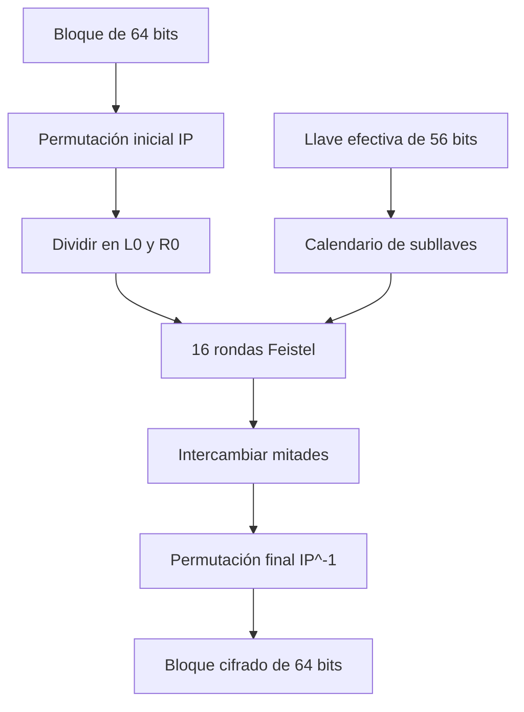

En cada ronda `i` se calcula:

```text
L_i = R_(i-1)
R_i = L_(i-1) XOR f(R_(i-1), K_i)
```

La función `f` expande 32 bits a 48, aplica XOR con una subllave, reduce el resultado mediante ocho cajas S y finalmente aplica una permutación. El descifrado ejecuta la misma estructura con las subllaves en orden inverso.

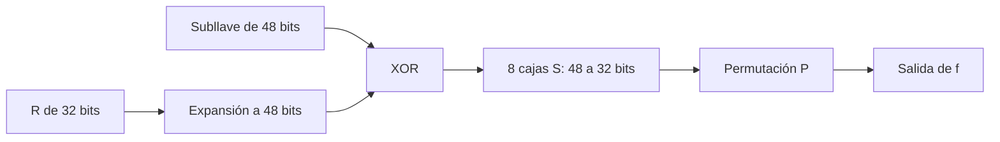

La implementación usa `DES_ecb_encrypt` de OpenSSL por compatibilidad con el requisito. OpenSSL clasifica DES entre sus algoritmos legacy y documenta DES-ECB dentro de ese proveedor [3]. Se emplea ECB porque permite reproducir el ejercicio, no porque sea un modo seguro.

### 4.2 Padding y datos binarios

DES requiere múltiplos de ocho bytes. Se agregó padding PKCS#7: si faltan `p` bytes, se añaden `p` bytes con valor `p`. Incluso un mensaje ya alineado recibe un bloque completo de padding. Al descifrar se comprueba que todos los bytes finales tengan el valor esperado.

El ciphertext se trata como un arreglo binario acompañado por una longitud. No se utiliza `strlen`, porque un byte cero puede aparecer en cualquier posición. Esta corrección evita uno de los errores del programa base.

### 4.3 Fuerza bruta y validación

Para cada llave candidata:

1. Se expande el valor de 56 bits a ocho grupos de siete bits.
2. OpenSSL agrega paridad impar a cada byte DES.
3. Se descifra el ciphertext completo.
4. Se valida el padding.
5. Se busca la frase conocida en el plaintext.

La frase debe ser suficientemente larga para que una llave incorrecta tenga una probabilidad despreciable de producirla por azar.

### 4.4 Métricas

Sea `T_s` la mediana secuencial y `T_p` la mediana con `p` procesos:

```text
speedup(p) = T_s / T_p
eficiencia(p) = speedup(p) / p
```

También se registra eficiencia por worker. En master-worker el proceso 0 coordina y no prueba llaves, de modo que con cuatro procesos existen tres workers:

```text
eficiencia_workers = speedup / cantidad_de_workers
```

Los intentos deben analizarse junto con el tiempo. Si una versión paralela prueba menos candidatos que la secuencial debido a la posición de la llave, puede mostrar speedup superlineal sin procesar candidatos a una tasa superior.

## 5. Diseño e implementación

### 5.1 Arquitectura

```text
include/project2/               Interfaces públicas
src/common.c                    Parsing, errores y temporización
src/file_io.c                   Entrada/salida binaria
src/des_crypto.c                DES, paridad y padding
src/search.c                    Validación y búsqueda por rango
apps/des_tool.c                 Cifrado y descifrado de archivos
apps/bruteforce_seq.c           Línea base secuencial
apps/bruteforce_mpi.c           Naive y cíclica
apps/bruteforce_mpi_dynamic.c   Master-worker
scripts/benchmark.py            Campaña y análisis estadístico
tests/                          Pruebas unitarias y de integración
```

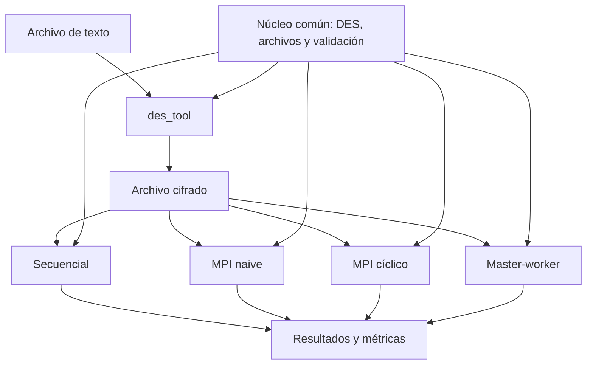

Esta estructura asegura que todas las estrategias utilicen exactamente el mismo cifrado y criterio de coincidencia.

### 5.2 Flujo de cifrado y descifrado

`des_tool` recibe `encrypt` o `decrypt`, rutas de entrada/salida y una llave. La lectura y escritura son binarias. El cifrado reserva la salida con padding; el descifrado recibe un búfer cuya capacidad es al menos `ciphertext_length + 1` para permitir una terminación nula auxiliar sin perder la longitud real.

### 5.3 Programación defensiva

La implementación incluye:

- rechazo de llaves fuera de `[0, 2^56)`;
- rechazo de enteros negativos, incluso con espacios iniciales;
- rangos semiabiertos para evitar duplicar extremos;
- validación de tamaños antes de convertir a conteos MPI de tipo `int`;
- cierre de archivos en rutas exitosas y de error;
- liberación de buffers en todos los procesos;
- representación separada de `found` y `key`, permitiendo la llave cero;
- sentinel `UINT64_MAX`, fuera del espacio DES, en reducciones MPI;
- inicialización del resultado incluso ante entradas inválidas;
- prueba del núcleo con ASan y UBSan mediante `make test-sanitize`.

## 6. Estrategias de búsqueda

### 6.1 Secuencial

La línea base recorre `[start_key, max_key)` con stride uno. Su tiempo es la referencia del speedup.

```text
para key desde 0 hasta max_key - 1:
    si try_key(key):
        devolver key
```

### 6.2 MPI naive

El espacio se divide en bloques contiguos. Para `N` procesos y un total `M`, se reparte cociente y residuo para que todos los candidatos pertenezcan exactamente a un proceso.

```text
Proceso 0: [0, ...)
Proceso 1: [..., ...)
...
Proceso N-1: [..., M)
```

Cada proceso examina `check_interval` candidatos y participa en operaciones colectivas. `MPI_Allreduce` obtiene la menor llave reportada, propaga errores y determina si quedan procesos activos. El protocolo conserva el mismo orden de colectivas en todos los ranks.

Su limitación es la correlación entre el valor de la llave y el inicio del bloque. Una llave al principio de un bloque no inicial puede encontrarse casi inmediatamente; una llave al final del primer bloque obliga a todos a recorrer gran parte de sus segmentos.

### 6.3 MPI cíclico

El proceso `rank` prueba:

```text
rank, rank + N, rank + 2N, rank + 3N, ...
```

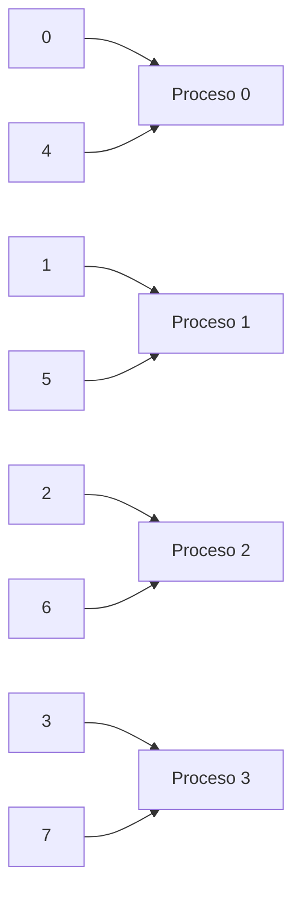

No se repiten candidatos y todos los procesos avanzan desde el comienzo lógico del espacio. La comunicación de terminación es la misma que en naive.

### 6.4 Master-worker dinámico

El rank 0 mantiene `next_key`. Los workers solicitan bloques `[start, end)`. El tamaño `chunk_size` equilibra comunicación y capacidad de detenerse pronto.

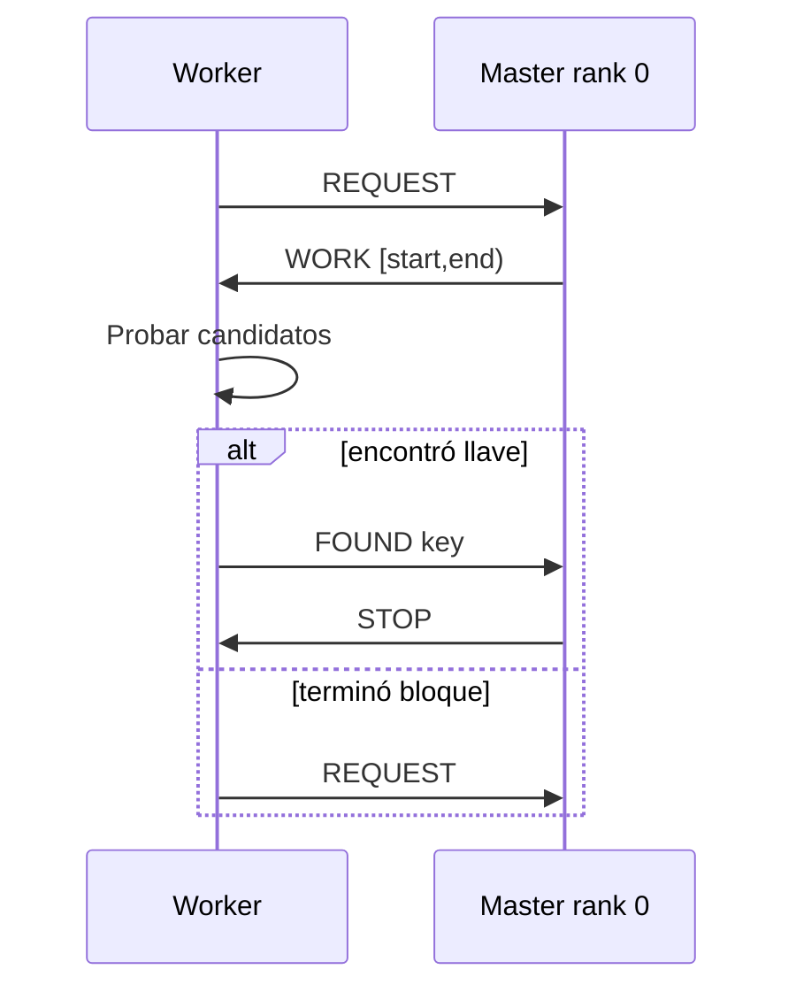

Los mensajes se distinguen mediante tags `REQUEST`, `WORK`, `FOUND`, `STOP` y `ERROR`. Después de recibir un resultado, el master deja de asignar bloques y responde `STOP` cuando cada worker termina el bloque en curso. Así se evitan envíos de parada potencialmente bloqueantes hacia procesos que todavía no han publicado una recepción.

El master no prueba llaves. Esta decisión simplifica el protocolo, pero reduce en uno la cantidad de procesos de cómputo.

## 7. Metodología experimental

### 7.1 Entorno

- Ubuntu 24.04.1 sobre WSL 2, kernel `6.6.87.2-microsoft-standard-WSL2`.
- GCC 13.3.0 con C11 y optimización `-O2`.
- OpenSSL 3.0.13.
- Open MPI 4.1.6.
- Python 3.12.3 para las campañas.
- Texto: `Esta es una prueba de proyecto 2`.
- Frase: `es una prueba de`.

Las pruebas se hicieron en una computadora, no en un clúster físico. Las
versiones pueden consultarse nuevamente con `bash scripts/environment.sh`.

### 7.2 Rango reducido

Ejecutar repetidamente todo `2^56` no es viable. Se definió:

```text
M = 1 000 000
```

Las llaves conservan las posiciones relativas del enunciado:

| Clase | Fórmula | Llave |
|---|---:|---:|
| Fácil | `M/2 + 1` | 500001 |
| Media | `M/2 + M/8` | 625000 |
| Difícil | `ceil(M/7 + M/13)` | 219781 |

La clasificación se refiere a la dificultad para la partición naive con cuatro procesos. La llave fácil cae al inicio de un bloque y la difícil cerca del final del primer bloque.

### 7.3 Diseño de la campaña

- Procesos MPI: 2 y 4.
- Repeticiones medidas: 5.
- Warmups: 1 por combinación.
- Intervalo naive/cíclico: 4096.
- Bloque dinámico: 4096.
- Orden de ejecución pseudoaleatorio con semilla 2026.
- Total: 105 ejecuciones medidas.

`benchmark.py` cifra cada entrada, ejecuta todas las estrategias, valida la llave recuperada y escribe cada resultado inmediatamente en `raw.csv`. Después agrupa por llave, estrategia y procesos para generar `summary.csv`.

### 7.4 Casos literales y definición del tiempo

El 13 de octubre se agregó una campaña separada para la llave `123456` con
`max-key=2^56`, `-np 4`, cinco repeticiones y un calentamiento. Para
`2^56/4 = 18014398509481984`, la variante naive buscó en el rango completo.
Para `2^56/4 - 1 = 18014398509481983`, se cifró con esa llave pero solo se
examinó el prefijo `[0,1000000)` mediante cuatro procesos. Cada subproceso
tuvo un límite de 30 segundos. La configuración exacta, los CSV y los logs
se describen en [CASOS_LITERAL.md](../docs/CASOS_LITERAL.md).

Para el inciso A.3 se midió por separado la búsqueda secuencial de seis
llaves de uno a seis dígitos decimales, con cinco repeticiones cada una y
`max-key=200000`. La cantidad de dígitos no altera el tamaño criptográfico
efectivo de DES, que sigue siendo de 56 bits; cambia la posición de la
solución en el orden incremental.

`Tiempo` en las aplicaciones mide la región de búsqueda. No incluye todo el
arranque, cifrado, lectura, difusión inicial ni salida final. El CSV de
frontera añade `wall_seconds`, medido desde antes de iniciar `mpirun` hasta su
salida. Las dos magnitudes se presentan por separado; los speedups de las
tablas siguientes usan solamente tiempos de búsqueda comparables.

## 8. Resultados

### 8.1 Speedup

| Clase | Naive 2 | Naive 4 | Cíclico 2 | Cíclico 4 | Dinámico 2 | Dinámico 4 |
|---|---:|---:|---:|---:|---:|---:|
| Fácil | 120.907 | 117.104 | 1.853 | 2.922 | 0.982 | 2.388 |
| Media | 4.730 | 3.214 | 1.843 | 2.686 | 0.958 | 2.487 |
| Difícil | 0.951 | 0.734 | 1.873 | 2.830 | 0.975 | 2.425 |

### 8.2 Resultados con cuatro procesos

| Clase | Estrategia | Intentos medianos | Tiempo mediano (s) | Speedup | Eficiencia total |
|---|---|---:|---:|---:|---:|
| Fácil | Naive | 12290 | 0.002240 | 117.104 | 29.276 |
| Fácil | Cíclica | 505929 | 0.089765 | 2.922 | 0.731 |
| Fácil | Dinámica | 500002 | 0.109849 | 2.388 | 0.597 |
| Media | Naive | 505929 | 0.101022 | 3.214 | 0.804 |
| Media | Cíclica | 635483 | 0.120869 | 2.686 | 0.672 |
| Media | Dinámica | 625001 | 0.130531 | 2.487 | 0.622 |
| Difícil | Naive | 883334 | 0.158445 | 0.734 | 0.183 |
| Difícil | Cíclica | 226978 | 0.041087 | 2.830 | 0.707 |
| Difícil | Dinámica | 227974 | 0.047933 | 2.425 | 0.606 |

### 8.3 Estabilidad

El naive varió entre 0.734 y 120.907. En contraste:

- cíclico con dos procesos: 1.843–1.873;
- cíclico con cuatro procesos: 2.686–2.922;
- dinámico con dos procesos: 0.958–0.982;
- dinámico con cuatro procesos: 2.388–2.487.

### 8.4 Mediciones de las llaves solicitadas literalmente

Con la llave `123456` y `max-key=2^56`, las 20 ejecuciones recuperaron la
llave. Las medianas de cinco repeticiones por modalidad fueron:

| Modalidad | Procesos | Intentos | Búsqueda mediana (s) | Speedup |
|---|---:|---:|---:|---:|
| Secuencial | 1 | 123457 | 0.065287287 | 1.000000 |
| MPI naive | 4 | 504385 | 0.099789442 | 0.654250 |
| MPI cíclico | 4 | 129169 | 0.018180595 | 3.591042 |
| MPI dinámico | 4 (3 workers) | 123457 | 0.024421049 | 2.673402 |

La llave `18014398509481984` se encontró con naive y cuatro procesos en el
rango `[0,2^56)`: mediana de 12289 intentos, `0.002423341 s` de búsqueda y
`0.398726026 s` de tiempo total del subproceso. Para
`18014398509481983`, se midió solamente el prefijo `[0,1000000)`: un millón
de intentos, `0.165618548 s` de búsqueda y `1.552298223 s` de tiempo total
medianos, sin hallazgo **dentro de ese prefijo**. Cada caso tuvo cinco
repeticiones medidas. Los valores completos están en
[`results/required-boundary/`](../results/required-boundary/summary.csv).

Una extrapolación condicional a rendimiento constante del caso acotado da
aproximadamente 378 años para que el rank 0 alcance el final de su segmento
de `2^54` llaves. **No es una medición completa ni una cota garantizada.** La
fórmula, los supuestos y sus límites figuran en `docs/CASOS_LITERAL.md`.

En la serie secuencial por longitud decimal, las medianas de búsqueda para
llaves `9`, `99`, `999`, `9999`, `99999` y `123456` fueron respectivamente
`0.000017744`, `0.000063639`, `0.000522524`, `0.005212388`,
`0.051894619` y `0.064412157 s`. Correspondieron a 10, 100, 1000, 10000,
100000 y 123457 intentos. Los tiempos de pocos microsegundos son sensibles
al ruido; la serie demuestra el costo del recorrido incremental, no una
comparación entre algoritmos DES de distinta longitud de llave. Los 30 datos
originales y seis resúmenes están en `results/key-lengths/`.

## 9. Discusión

### 9.1 Speedup artificial del naive

Con la llave 500001 y dos procesos, el segundo bloque comienza en 500000. El proceso correspondiente encuentra la solución en su segundo candidato. Debido al intervalo de sincronización, el total fue 4098 intentos, frente a 500002 secuenciales. El speedup 120.907 y la eficiencia 60.453 no significan que cada núcleo sea decenas de veces más rápido: el algoritmo paralelo realizó mucho menos trabajo.

Con cuatro procesos sucede algo parecido: la llave está al inicio del bloque del proceso 2. Se registraron 12290 intentos y speedup 117.104.

### 9.2 Caso difícil del naive

La llave 219781 se encuentra cerca del final del primer bloque de `[0,250000)`. Mientras el proceso 0 avanza, los otros procesos recorren cantidades similares en bloques que no contienen la solución. El total mediano fue 883334 intentos y el speedup cayó a 0.734. El costo de comunicación y sincronización hizo al paralelo más lento que el secuencial.

### 9.3 Distribución cíclica

La cíclica obtuvo la mejor combinación de velocidad y regularidad. Con cuatro procesos alcanzó speedups entre 2.686 y 2.922. El costo por candidato es uniforme, por lo que no se necesita un coordinador dinámico para balancear workers. Su comunicación ocurre solamente al final de cada intervalo colectivo.

### 9.4 Master-worker

Con dos procesos existe un solo worker; por ello, el speedup queda ligeramente por debajo de uno. Con cuatro procesos hay tres workers y se obtuvieron speedups de 2.388 a 2.487. La eficiencia por worker fue de 0.796 a 0.829, superior a la eficiencia calculada con procesos totales.

La estrategia dinámica es más compleja y envía mensajes por bloque, pero permite controlar el trabajo residual mediante `chunk_size`. Podría ser útil si el costo de cada candidato fuera irregular o si los workers tuvieran capacidades heterogéneas; esa situación no se ensayó aquí.

### 9.5 Amenazas a la validez

1. La campaña comparativa redujo el rango a un millón de candidatos; conserva posiciones relativas elegidas, pero no representa la duración absoluta de `2^56`.
2. Las mediciones se realizaron en una sola computadora mediante WSL, no en un cluster físico.
3. Los speedups excluyen preparación, arranque y cifrado; miden la región de búsqueda, no el tiempo total del programa.
4. Cinco repeticiones permiten usar medianas, aunque una campaña de mayor duración caracterizaría mejor la variación del sistema.
5. `check_interval` y `chunk_size` se fijaron en 4096; otros valores pueden cambiar el balance entre comunicación y trabajo desperdiciado.
6. Las tres posiciones de llave fueron seleccionadas para contrastar comportamientos. No forman una muestra aleatoria del espacio DES, por lo que no permiten estimar el rendimiento esperado para una llave uniforme.
7. El caso `2^56/4 - 1` solo se probó en un prefijo finito; su extrapolación supone rendimiento constante durante unas once órdenes de magnitud adicionales y no sustituye la medición.
8. Los CSV históricos registran `git_revision=ec5c495` y `git_dirty=yes`; los nuevos registran `01c1151` y `git_dirty=yes`. Ninguno prueba por sí solo un estado de código limpio. El CSV nuevo de frontera agrega hashes SHA-256 de binario, entrada y cifrado.

## 10. Conclusiones

1. Se implementaron correctamente cifrado, descifrado y búsqueda de llaves DES sobre datos cargados desde archivos.
2. La separación del núcleo permitió comparar cuatro modalidades con las mismas operaciones criptográficas y el mismo criterio de validación.
3. En las posiciones ensayadas, el speedup de la partición naive dependió drásticamente de la posición de la llave; no se estimó su tiempo esperado sobre todas las llaves.
4. Los speedups superlineales observados en naive fueron consecuencia de ejecutar menos intentos, no de una eficiencia física superior a uno.
5. En esta computadora y configuración, la distribución cíclica fue la alternativa más rápida y regular de las dos propuestas para la carga uniforme ensayada.
6. Master-worker produjo resultados estables y terminación coordinada, pero el master dedicado redujo el paralelismo efectivo.
7. Reportar intentos, mediana y parámetros experimentales es indispensable para interpretar correctamente el rendimiento.
8. El caso literal al inicio del segundo bloque se completó; el caso al final del primero quedó acotado y su tiempo total solo se extrapoló.

## 11. Recomendaciones

1. Utilizar la distribución cíclica como implementación principal para este problema.
2. Conservar master-worker cuando exista heterogeneidad, costo irregular o necesidad de ajustar trabajo residual.
3. Explorar varios valores de `check_interval` y `chunk_size` antes de una ejecución en cluster.
4. Medir por separado throughput criptográfico, comunicación y tiempo total de extremo a extremo.
5. Para aplicaciones reales, reemplazar DES y ECB por un algoritmo y modo moderno autenticado.
6. Ejecutar una campaña adicional en máquinas físicas conectadas por red para estudiar latencia y escalabilidad distribuida.

## 12. Referencias

[1] National Institute of Standards and Technology. *FIPS PUB 46-3: Data Encryption Standard (DES)*, 1999; retirado en 2005. https://csrc.nist.gov/pubs/fips/46-3/final

[2] E. Barker y A. Roginsky. *NIST SP 800-131A Rev. 2: Transitioning the Use of Cryptographic Algorithms and Key Lengths*, 2019. https://csrc.nist.gov/pubs/sp/800/131/a/r2/final

[3] OpenSSL Project. *OpenSSL 3.0 Legacy Provider* y *EVP_CIPHER-DES*. https://docs.openssl.org/3.0/man7/OSSL_PROVIDER-legacy y https://docs.openssl.org/3.0/man7/EVP_CIPHER-DES/

[4] Message Passing Interface Forum. *MPI: A Message-Passing Interface Standard, Version 4.1*, 2023. https://www.mpi-forum.org/docs/mpi-4.1/mpi41-report.pdf

[5] National Institute of Standards and Technology. *Special Publication 800-17: Modes of Operation Validation System (MOVS): Requirements and Procedures*, apéndice B, tabla 1, vector DES-ECB de texto variable. https://nvlpubs.nist.gov/nistpubs/Legacy/SP/nistspecialpublication800-17.pdf

## 13. Anexo A: catálogo de funciones

### A.1 Núcleo común

| Función | Entradas | Salidas | Propósito |
|---|---|---|---|
| `project2_status_message` | `Project2Status status` | `const char *` | Convierte un código interno en mensaje legible. |
| `project2_parse_u64` | texto y puntero de salida | `bool`, valor de 64 bits | Analiza enteros sin signo y rechaza texto inválido, negativos y overflow. |
| `project2_monotonic_seconds` | ninguna | `double` | Obtiene tiempo monotónico para medición secuencial. |
| `project2_read_file` | ruta, punteros de datos y longitud | `Project2Status` | Lee un archivo completo en modo binario y agrega un byte auxiliar nulo. |
| `project2_write_file` | ruta, datos y longitud | `Project2Status` | Escribe exactamente la cantidad indicada y verifica el cierre. |
| `project2_des_encrypt` | llave, plaintext y longitud | ciphertext asignado y longitud | Agrega PKCS#7, prepara la llave y cifra bloques DES-ECB. |
| `project2_des_decrypt` | llave, ciphertext, capacidad | plaintext y longitud | Descifra, valida PKCS#7 y termina el búfer auxiliarmente. |
| `project2_buffer_contains` | buffer, longitudes y patrón | `bool` | Busca una secuencia binaria sin depender de terminadores nulos. |
| `project2_try_key` | llave candidata, ciphertext, frase y búfer | bandera `matches` | Descifra una candidata y comprueba la frase conocida. |
| `project2_search_range` | datos, frase, inicio, fin y stride | `Project2SearchResult` | Recorre un rango y registra llave, intentos y tiempo. |

### A.2 Aplicaciones

| Función | Archivo | Propósito |
|---|---|---|
| `parse_arguments` | `des_tool.c` | Valida operación, rutas y llave. |
| `main` | `des_tool.c` | Coordina lectura, cifrado/descifrado y escritura. |
| `parse_arguments` | `bruteforce_seq.c` | Valida frase y rango secuencial. |
| `main` | `bruteforce_seq.c` | Ejecuta la línea base y recupera el plaintext. |
| `partition_range` | `bruteforce_mpi.c` | Divide el rango contiguo distribuyendo el residuo. |
| `main` | `bruteforce_mpi.c` | Distribuye entrada y ejecuta naive o cíclico según el binario. |
| `parse_arguments` | `bruteforce_mpi_dynamic.c` | Valida entrada, rango y tamaño de bloque. |
| `send_stop` | `bruteforce_mpi_dynamic.c` | Envía una respuesta de parada a un worker listo. |
| `run_master` | `bruteforce_mpi_dynamic.c` | Asigna bloques y procesa solicitudes, resultados y errores. |
| `run_worker` | `bruteforce_mpi_dynamic.c` | Solicita bloques, prueba llaves y reporta el resultado. |

### A.3 Funciones solicitadas en el programa base

- `encrypt(key, ciph, len)`: en el proyecto corresponde a `project2_des_encrypt`; prepara la llave, aplica padding y cifra bloques.
- `decrypt(key, ciph, len)`: corresponde a `project2_des_decrypt`; descifra y valida padding.
- `tryKey(key, ciph, len)`: corresponde a `project2_try_key`; prueba una llave sin modificar el ciphertext original.
- `memcpy(destino, origen, n)`: copia exactamente `n` bytes entre regiones no superpuestas. Se usa para manejar bloques y datos binarios con longitud explícita.
- `strstr(texto, patrón)`: busca un substring en cadenas terminadas en cero. El proyecto utiliza `project2_buffer_contains`, equivalente pero seguro para buffers binarios y longitudes explícitas.

### A.4 Catálogo detallado: núcleo común

En la tabla, `const` señala datos que la rutina no modifica; los punteros de
salida se indican expresamente. `Project2Status` distingue éxito, argumentos
inválidos, entrada/salida, memoria, criptografía y llave no encontrada.

| Rutina | Entradas: nombre, tipo y uso | Salidas: nombre, tipo y significado |
|---|---|---|
| `project2_status_message` | `status: Project2Status`, código a describir. | Retorno `const char *`: texto estático del estado. |
| `project2_parse_u64` | `text: const char *`, número textual; `value: uint64_t *`, destino. | Retorno `bool`: indica análisis válido; `*value: uint64_t`, entero analizado si es válido. |
| `project2_monotonic_seconds` | Sin parámetros. | Retorno `double`: segundos del reloj monotónico. |
| `project2_read_file` | `path: const char *`, ruta de lectura; `data: unsigned char **` y `length: size_t *`, destinos. | Retorno `Project2Status`; `*data: unsigned char *`, búfer asignado que libera el llamador; `*length: size_t`, bytes leídos. |
| `project2_write_file` | `path: const char *`, ruta de escritura; `data: const unsigned char *`, bytes; `length: size_t`, cantidad exacta. | Retorno `Project2Status`: estado de escritura y cierre. |
| `project2_des_encrypt` | `key: uint64_t`, llave efectiva de 56 bits; `plaintext: const unsigned char *`, entrada; `plaintext_length: size_t`, bytes; `ciphertext: unsigned char **` y `ciphertext_length: size_t *`, destinos. | Retorno `Project2Status`; `*ciphertext: unsigned char *`, bloques DES asignados; `*ciphertext_length: size_t`, longitud con padding. |
| `project2_des_decrypt` | `key: uint64_t`, llave; `ciphertext: const unsigned char *`, bloques; `ciphertext_length: size_t`, bytes; `plaintext: unsigned char *`, búfer de salida; `plaintext_capacity: size_t`, capacidad; `plaintext_length: size_t *`, destino. | Retorno `Project2Status`; `plaintext`, texto descifrado sin padding; `*plaintext_length: size_t`, bytes útiles. |
| `project2_buffer_contains` | `buffer: const unsigned char *`, datos; `buffer_length: size_t`, longitud; `needle: const unsigned char *`, patrón; `needle_length: size_t`, longitud del patrón. | Retorno `bool`: verdadero si el patrón aparece en el búfer. |
| `project2_try_key` | `key: uint64_t`, candidata; `ciphertext: const unsigned char *` y `ciphertext_length: size_t`, cifrado; `known_phrase: const unsigned char *` y `known_phrase_length: size_t`, frase; `work_buffer: unsigned char *` y `work_buffer_capacity: size_t`, espacio reutilizable; `matches: bool *`, destino. | Retorno `Project2Status`; `*matches: bool`, indica padding válido y frase presente. |
| `project2_search_range` | `ciphertext: const unsigned char *` y `ciphertext_length: size_t`, cifrado; `known_phrase: const unsigned char *` y `known_phrase_length: size_t`, frase; `start_key: uint64_t`, inicio inclusivo; `end_key: uint64_t`, fin exclusivo; `stride: uint64_t`, paso positivo; `result: Project2SearchResult *`, destino. | Retorno `Project2Status`; `*result` contiene `found: bool`, `key: uint64_t`, `attempts: uint64_t` y `elapsed_seconds: double`. Con puntero no nulo queda inicializado incluso ante entrada inválida. |

### A.5 Catálogo detallado: aplicaciones y comunicación

Las cuatro aplicaciones reciben `main(argc: int, argv: char **)`, donde
`argc` es el número de argumentos y `argv` sus cadenas. Cada `main` devuelve
`int`: `EXIT_SUCCESS` si completó la operación y `EXIT_FAILURE` ante error o
llave no encontrada; además escribe el estado y las métricas aplicables.

| Rutina (archivo) | Entradas: nombre, tipo y uso | Salidas: nombre, tipo y significado |
|---|---|---|
| `print_usage` (cada aplicación) | `program: const char *`, nombre del ejecutable. | Retorno `void`; escribe sintaxis en `stderr`. |
| `parse_arguments` (`des_tool.c`) | `argc: int`, cantidad; `argv: char **`, opciones; `operation: const char **`, `input_path: const char **`, `output_path: const char **`, `key: uint64_t *`, destinos. | Retorno `bool`; los cuatro punteros de destino reciben operación, rutas y llave validadas si es verdadero. |
| `parse_arguments` (`bruteforce_seq.c`) | `argc: int`, cantidad; `argv: char **`, opciones; `options: Options *`, destino. | Retorno `bool`; `options` recibe `input_path: const char *`, `phrase: const char *`, `start_key: uint64_t`, `end_key: uint64_t`. |
| `parse_arguments` (`bruteforce_mpi.c`) | `argc: int`, cantidad; `argv: char **`, opciones; `options: Options *`, destino del rank 0. | Retorno `bool`; `options` recibe rutas/frase y `max_key: uint64_t`, `check_interval: uint64_t`. |
| `partition_range` (`bruteforce_mpi.c`) | `total: uint64_t`, tamaño global; `rank: int`, proceso; `process_count: int`, cantidad de procesos; `start: uint64_t *` y `end: uint64_t *`, destinos. | Retorno `void`; `*start` y `*end` delimitan el bloque contiguo semiabierto del rank. |
| `parse_arguments` (`bruteforce_mpi_dynamic.c`) | `argc: int`, cantidad; `argv: char **`, opciones; `options: Options *`, destino del master. | Retorno `bool`; `options` recibe `input_path: const char *`, `phrase: const char *`, `max_key: uint64_t` y `chunk_size: uint64_t`. |
| `send_stop` (`bruteforce_mpi_dynamic.c`) | `worker: int`, rank destinatario que ya solicitó o reportó. | Retorno `void`; envía dos `uint64_t` con tag `TAG_STOP`. |
| `run_master` (`bruteforce_mpi_dynamic.c`) | `worker_count: int`, workers; `max_key: uint64_t`, fin global; `chunk_size: uint64_t`, tamaño de bloque; `global_key: uint64_t *` y `valid: int *`, estados compartidos por referencia. | Retorno `void`; `*global_key` queda en la llave informada o `UINT64_MAX`; `*valid` indica error de protocolo o worker. Envía bloques `WORK` o `STOP`. |
| `run_worker` (`bruteforce_mpi_dynamic.c`) | `ciphertext: const unsigned char *`, cifrado; `ciphertext_length: size_t`, bytes; `phrase: const unsigned char *`, frase; `phrase_length: size_t`, bytes; `work_buffer: unsigned char *`, búfer; `local_attempts: uint64_t *`, contador. | Retorno `void`; incrementa `*local_attempts` y comunica `REQUEST`, `FOUND` o `ERROR` al master. |

### A.6 Bibliotecas y encabezados utilizados

| Biblioteca o encabezado | Uso en el proyecto | Rutinas o tipos relevantes |
|---|---|---|
| OpenSSL (`openssl/des.h`, `-lcrypto`) | Cifrado y descifrado de bloques DES después de construir la llave con paridad. | `DES_set_odd_parity`, `DES_set_key_unchecked`, `DES_ecb_encrypt`, `DES_key_schedule` |
| Open MPI (`mpi.h`, compilación con `mpicc`) | Difusión de la entrada, sincronización, reducción de resultados y protocolo entre master y workers. | `MPI_Bcast`, `MPI_Allreduce`, `MPI_Reduce`, `MPI_Send`, `MPI_Recv`, `MPI_Probe`, `MPI_Wtime` |
| Biblioteca estándar de C (`stdio.h`, `stdlib.h`, `string.h`) | Archivos binarios, memoria dinámica, copia de datos y salida diagnóstica. | `fopen`, `fread`, `fwrite`, `malloc`, `free`, `memcpy`, `fprintf` |
| Tipos y utilidades estándar (`stdint.h`, `stdbool.h`, `stddef.h`, `inttypes.h`, `time.h`) | Tamaños y enteros explícitos, booleanos, formato portable y reloj monotónico. | `uint64_t`, `bool`, `size_t`, `PRIu64`, `clock_gettime` |

Las interfaces propias en `include/project2/` aíslan estas dependencias del
resto de las aplicaciones. Las entradas y salidas de cada rutina propia se
describen en A.4 y A.5; las primitivas MPI se detallan en el Anexo B.

## 14. Anexo B: primitivas MPI

### B.1 Primitivas requeridas por el enunciado

| Primitiva | Funcionamiento | Consideración |
|---|---|---|
| `MPI_Irecv` | Publica una recepción no bloqueante y devuelve un `MPI_Request`. | El búfer y la solicitud deben permanecer válidos hasta completar o cancelar la operación. |
| `MPI_Send` | Envía un mensaje con buffer, cantidad, tipo, destino, tag y comunicador. | Puede bloquear hasta que sea seguro reutilizar el búfer; no debe suponerse que siempre usa buffering interno. |
| `MPI_Wait` | Espera la finalización de una solicitud no bloqueante. | Evita finalizar MPI dejando un `MPI_Request` pendiente. |

El programa original publicaba una recepción por proceso y enviaba el resultado individualmente. Este esquema podía dejar solicitudes o mensajes pendientes. La versión final usa colectivas en naive/cíclico y un protocolo request-response explícito en master-worker.

### B.2 Primitivas utilizadas

| Primitiva | Uso en el proyecto |
|---|---|
| `MPI_Init` / `MPI_Finalize` | Inicializan y cierran el entorno MPI. |
| `MPI_Comm_rank` | Obtiene el identificador del proceso. |
| `MPI_Comm_size` | Obtiene la cantidad total de procesos. |
| `MPI_Bcast` | Distribuye configuración, ciphertext y frase desde el rank 0. |
| `MPI_Barrier` | Alinea el inicio de la región medida. |
| `MPI_Allreduce` | Propaga errores, selecciona una llave y cuenta procesos activos. |
| `MPI_Reduce` | Suma intentos y obtiene el tiempo máximo en el root. |
| `MPI_Send` / `MPI_Recv` | Implementan solicitudes, trabajo, resultados y parada dinámica. |
| `MPI_Probe` | Permite al master conocer origen y tag antes de recibir. |
| `MPI_Wtime` | Mide tiempo paralelo local. |

El estándar MPI 4.1 especifica tanto comunicación punto a punto como operaciones colectivas [4]. La implementación mantiene tipos y conteos compatibles entre emisor y receptor y usa tags diferentes para los estados del protocolo.

## 15. Anexo C: reproducción y evidencia

### C.1 Compilación y pruebas ejecutadas

```bash
wsl.exe -d Ubuntu-24.04 -- make -B test-all
wsl.exe -d Ubuntu-24.04 -- make test-sanitize
python scripts/verify_results.py
```

El 13 de octubre de 2026 los tres comandos terminaron con código 0. La
recompilación forzada no produjo advertencias del compilador. La suite informó:

```text
OK: parser, archivos, DES, padding y busqueda secuencial.
OK: comandos, llaves limite y resultados de error.
OK: naive, ciclico, master-worker y errores MPI.
OK: CSV crudo, resumen, speedup y eficiencia.
```

`make test-sanitize` compiló el núcleo con `-fsanitize=address,undefined`,
`-fno-omit-frame-pointer` y ejecutó
`ASAN_OPTIONS=detect_leaks=1 ./bin/test_core_san`; terminó con el mensaje de
éxito del núcleo y sin
diagnósticos de sanitizadores. No se ejecutó MPI instrumentado. El vector DES
externo añadido a `test_core` usa la tabla 1 del apéndice B de NIST SP 800-17
[5]: llave DES `0101010101010101` (llave efectiva numérica 0), texto plano
`8000000000000000` y primer bloque cifrado esperado `95F8A5E5DD31D900`.
El segundo bloque producido por la API corresponde al padding PKCS#7 y no
forma parte del vector NIST. El verificador CSV confirmó 105 filas/21 grupos
históricos, 20 filas/4 grupos de 123456, 10 filas/2 grupos de frontera y 30
filas/6 grupos de longitudes decimales.

### C.2 Demostración

```bash
python scripts/capture_evidence.py
```

Este comando se ejecutó en un escritorio Windows visible. Abrió consolas
reales, ejecutó cifrado/descifrado, pruebas, búsquedas y resúmenes, y guardó
capturas en `evidence/`. Los tiempos de esas capturas son ejecuciones nuevas;
no se sustituyen por los valores medianos de los CSV. La correspondencia entre
imagen, comando y requisito está en [EVIDENCIA.md](../docs/EVIDENCIA.md).

### C.3 Campañas y procedencia

En esta actualización se ejecutaron los siguientes comandos nuevos:

```bash
python3 scripts/benchmark.py --skip-build --keys 123456 \
  --max-key 72057594037927936 --processes 4 --repetitions 5 --warmups 1 \
  --check-interval 4096 --chunk-size 4096 --seed 2026 \
  --output-dir results/required-123456
python3 scripts/required_boundary_cases.py \
  --output-dir results/required-boundary --prefix-max-key 1000000 \
  --repetitions 5 --warmups 1 --check-interval 4096 --timeout-seconds 30
python3 scripts/benchmark_key_lengths.py
```

La campaña histórica del 2 de octubre no se volvió a ejecutar ni se
sobrescribió. `make benchmark-final` sigue disponible para repetirla, pero
escribe sobre `results/final-campaign/`; use otro `--output-dir` si desea
preservar los archivos históricos.

Artefactos:

- `results/final-campaign/`: 105 observaciones y 21 grupos históricos.
- `results/required-123456/`: 20 observaciones y 4 grupos nuevos.
- `results/required-boundary/`: 10 observaciones, 2 grupos y logs nuevos.
- `results/key-lengths/`: 30 observaciones y 6 grupos secuenciales nuevos.
- `docs/CAMPANA.md`: análisis histórico; `docs/CASOS_LITERAL.md`: protocolo,
  mediciones y extrapolación de los casos nuevos.

Los CSV históricos indican `git_revision=ec5c495`, `git_dirty=yes`; los nuevos
indican `01c1151`, `git_dirty=yes`. La revisión registrada es la base Git, no
una identificación completa de los cambios sin confirmar. Las fuentes
versionadas de `src/`, `apps/`, `include/`, `scripts/` y `tests/` no muestran
diferencias entre `ec5c495` y el HEAD anterior a este trabajo, pero no se
dispone de una instantánea limpia de la ejecución histórica. El CSV nuevo de
frontera contiene hashes SHA-256 del binario y datos para reforzar su
procedencia. La campaña histórica se conservó sin reemplazar sus datos.

### C.4 Evidencia visual y pendientes externos

Las capturas reales se catalogan en [EVIDENCIA.md](../docs/EVIDENCIA.md) y se
enlazan directamente aquí:

| Ejecución | Captura |
|---|---|
| Cifrado, descifrado y comparación con llave 42 | [encrypt_decrypt_42.png](../evidence/encrypt_decrypt_42.png) |
| Suite, ASan y UBSan | [tests.png](../evidence/tests.png), [sanitizers.png](../evidence/sanitizers.png) |
| Tres estrategias MPI | [mpi_naive.png](../evidence/mpi_naive.png), [mpi_cyclic.png](../evidence/mpi_cyclic.png), [mpi_dynamic.png](../evidence/mpi_dynamic.png) |
| Llaves literales | [key_123456.png](../evidence/key_123456.png), [quarter_first.png](../evidence/quarter_first.png), [quarter_minus_one_prefix.png](../evidence/quarter_minus_one_prefix.png) |
| Resúmenes | [summaries.png](../evidence/summaries.png), [historical_summary.png](../evidence/historical_summary.png) |

El caso de `18014398509481983` se identifica en la captura como muestra de
prefijo, no como ruptura completa. La versión PDF se genera desde este Markdown
con `./scripts/build_report_pdf.ps1` en Windows; el generador calcula y
comprueba el índice antes de añadir los folios. Está en
[INFORME_FINAL.pdf](INFORME_FINAL.pdf). El DOCX de `EJEMPLOS/` orientó solo el
diseño: tamaño carta, portada centrada, índice y tipografía; su contenido no se
usó como fuente del informe.

Los nombres y carnés fueron proporcionados directamente por el equipo el 13 de
octubre de 2026; no se infirieron de los resultados ni del historial Git. No se
realizó el extra opcional de clúster de dos máquinas ni OpenMP; no se incluyen
capturas que sugieran lo contrario.

## 16. Anexo D: capturas de ejecución

Estas once imágenes son capturas de consola de ejecuciones reales. La explicación
de cada comando y su alcance está en [EVIDENCIA.md](../docs/EVIDENCIA.md). Las
medianas del informe proceden de los CSV, no de estas ejecuciones individuales.

### D.1 Cifrado y descifrado con llave 42

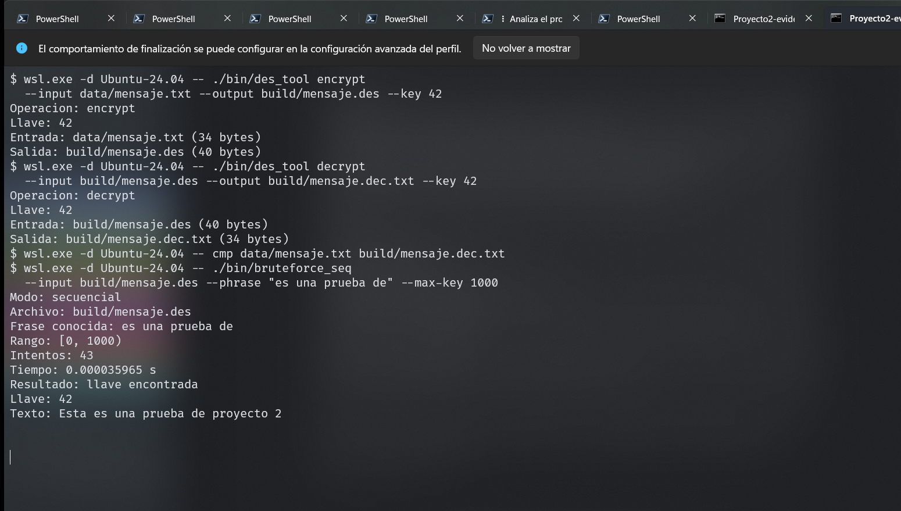

### D.2 Suite de pruebas y sanitizadores

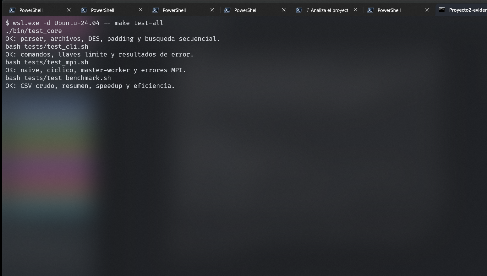

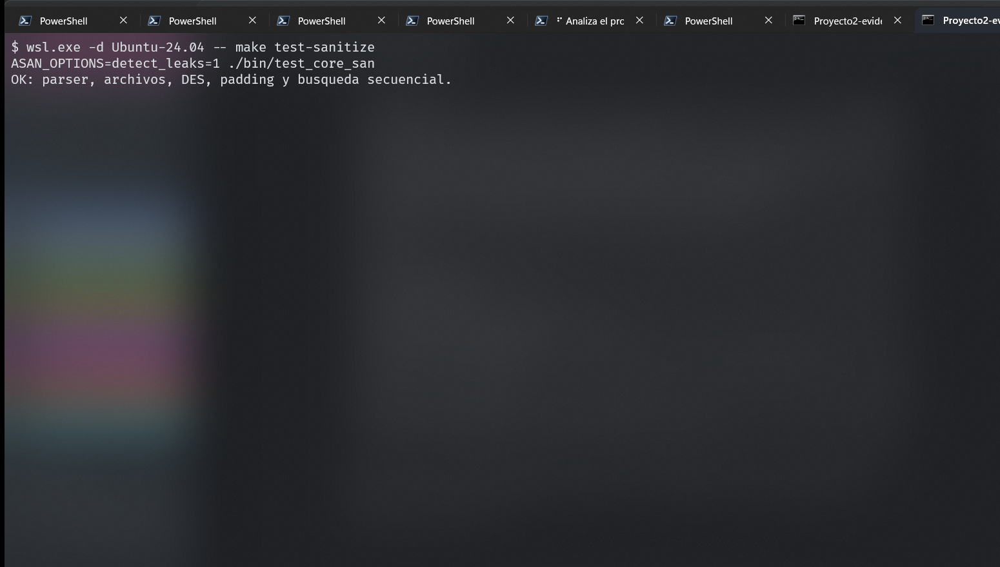

### D.3 Estrategias MPI


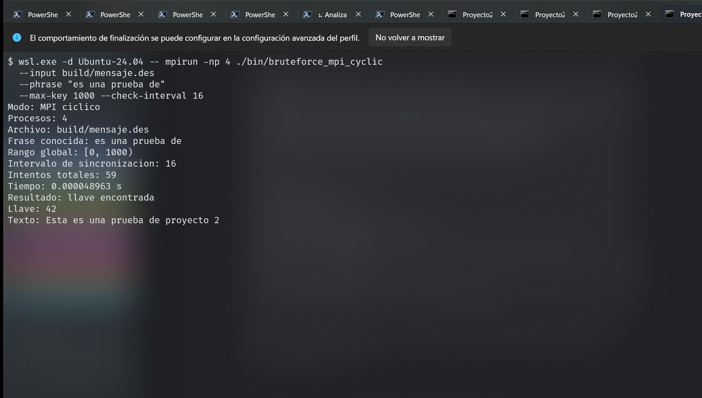

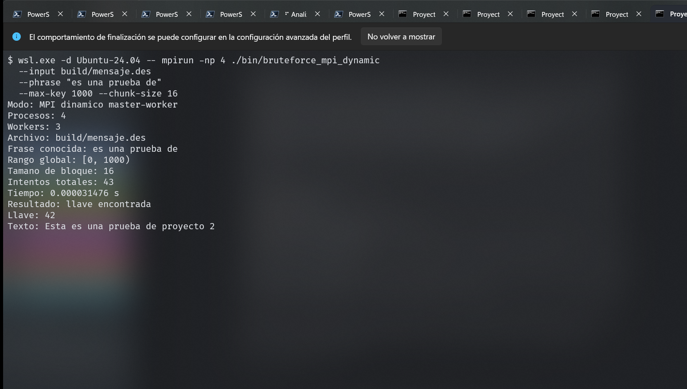

### D.4 Llaves literales solicitadas

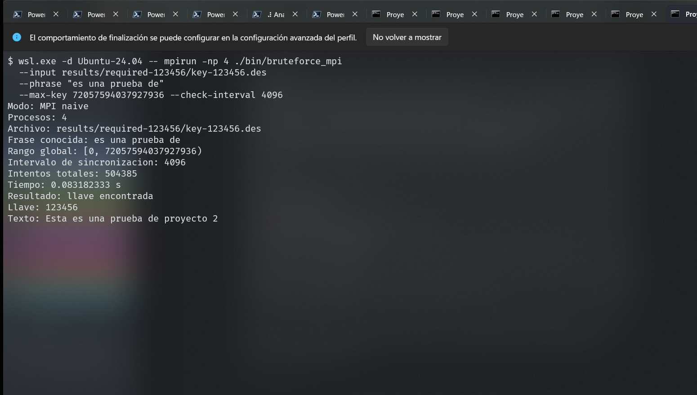

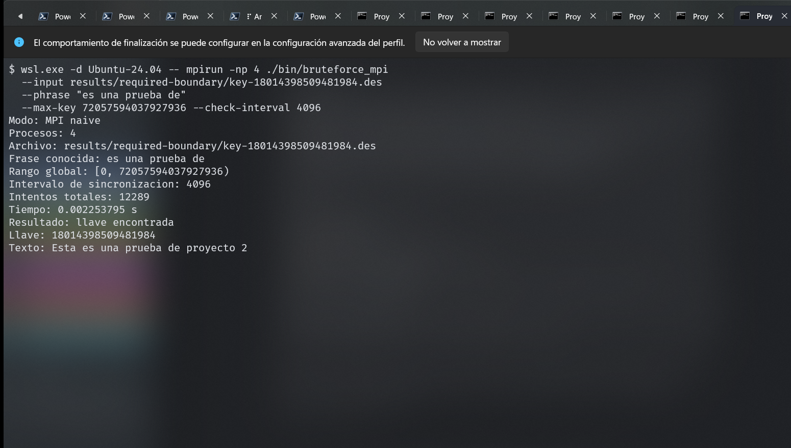

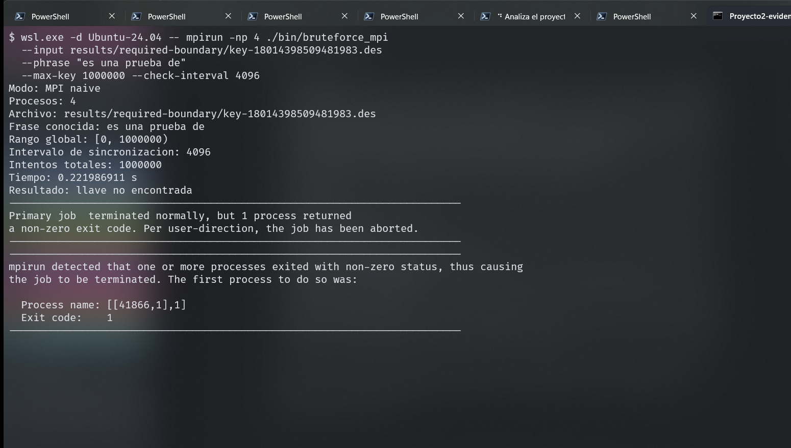

### D.5 Resúmenes

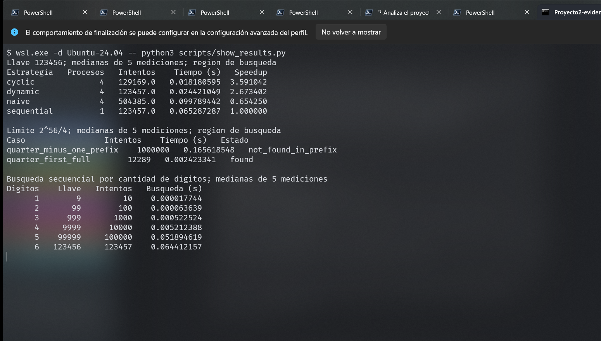

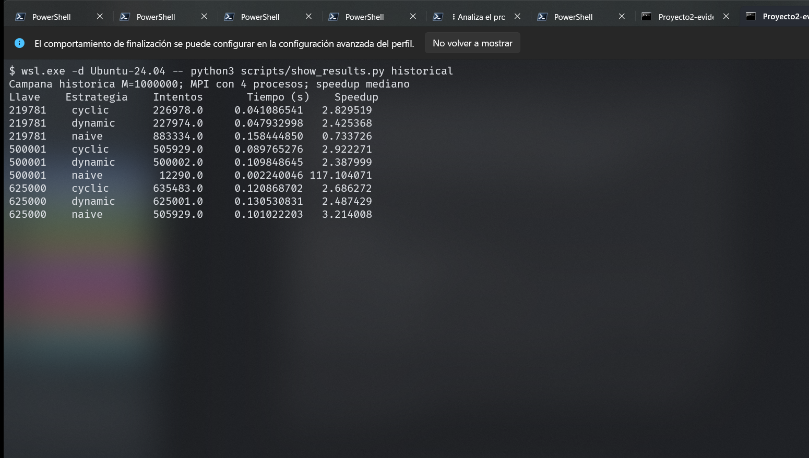
